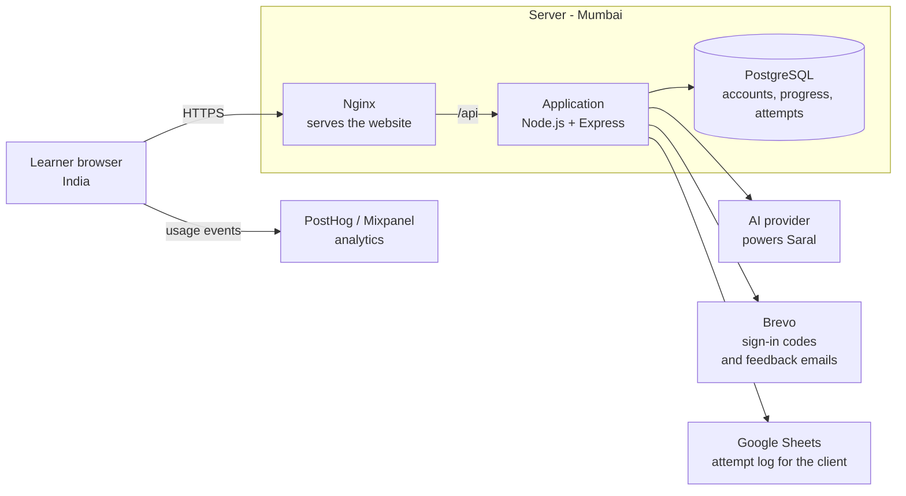
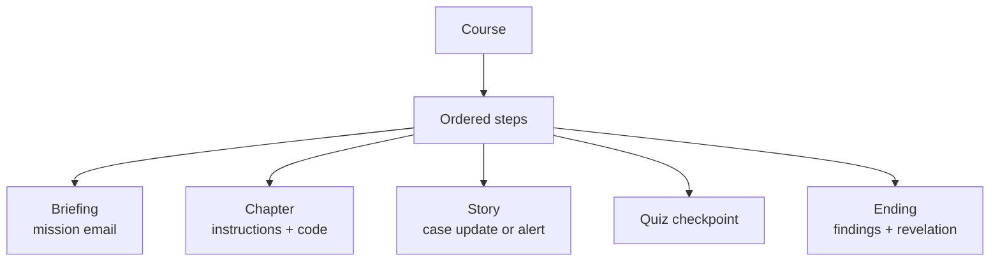
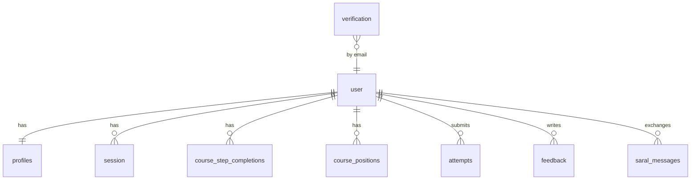

# AI Detective App — Architecture and Technical Design

Version 2 · 9 October 2026

---

## 1. The product in brief

A browser-based, story-driven web application that teaches learners to build an
AI agent by writing small pieces of code inside a detective narrative. Modelled
on CryptoZombies: short chapters, one code exercise each, with the story
advancing as the learner progresses. Each chapter teaches one idea, the learner
completes a piece of code, and the story moves forward as they progress.

The learner journey:

| Step | Screen |
|---|---|
| 1 | Homepage explaining the product and course |
| 2 | Sign in with email and a one-time code |
| 3 | Course selection |
| 4 | Mission briefing, shown as an email from Heal Genie |
| 5 | Detective name and preset avatar |
| 6 | Chapters: instructions on the left, code editor on the right, with Mentor Saral available |
| 7 | Story screens between chapters: case updates and alerts |
| 8 | Quiz checkpoints, timed, with answers and explanations shown after submitting |
| 9 | Mission end: the agent's findings, the revelation, code download, sharing, and next level coming soon |

Two missions, 12 to 15 chapters in total, on desktop and laptop browsers.
Progress is saved, so learners can leave and return where they stopped.

---

## 2. System architecture

Everything runs on one server: the website, the application and the database.
Learners are in India, so a single Mumbai server keeps the course fast without
extra infrastructure.



| Part | What it does |
|---|---|
| Browser | Runs the course: screens, code editor, answer checking, quiz scoring |
| Nginx | Serves the website over HTTPS and passes API calls to the application |
| Application | Sign-in, saved progress, attempts, Saral requests, feedback emails |
| Database | Learner accounts, progress, attempts, feedback |
| AI provider | Powers Saral; usage billed to account |
| Brevo | Delivers sign-in codes and feedback notifications |
| Google Sheets | Holds a readable copy of the attempt log for the client |
| PostHog / Mixpanel | Records how learners move through the course |

Learner code is never run anywhere. Answers are checked by comparing what the
learner wrote with the correct code, so there is no cost or security risk from
running code.

The frontend and backend live in separate code repositories, so each can be
updated independently.

### Technology stack

| Layer | Technology |
|---|---|
| Frontend | React 18 with Vite and TypeScript |
| Backend | Node.js with Express 5 and TypeScript |
| Database | PostgreSQL 18 |
| Data access | Prisma |
| Authentication | Better Auth — email one-time code, bearer token |
| Code editor | Monaco Editor |
| Styling | Tailwind CSS with shadcn/ui |
| Frontend libraries | React Router, TanStack Query, Zod |
| AI mentor | LLM provider with streaming replies |
| Email | Brevo |
| Attempt log sync | Google Sheets API, service account |
| Analytics | PostHog or Mixpanel |
| Web server | Nginx with Let's Encrypt |
| Hosting | Google Cloud, Mumbai region |

---

## 3. Course design

### Content is data, not code

Every mission, chapter, story screen and quiz lives in a content file that the
application reads and displays. Adding a new mission later means adding content,
not rebuilding the product. Each chapter and step has a permanent ID, so editing
text never affects saved learner progress.



### How content reaches both applications

Content lives in the frontend repository: a course file per mission, plus a
markdown file of instructions for each chapter. The frontend reads it directly.
The backend needs the same material for Mentor Saral.

A build step in the frontend repository reads each course file, inlines the
matching markdown into every step, and writes one `course-bundle.json` per
mission into the build output. Content validation runs before the bundle is
emitted.

The backend loads that bundle from a configured path when it starts and holds it
in memory — the nginx web root in production, a local checkout path in
development. One source of truth, no duplicated content, and no risk of the two
applications teaching different things. Content changes take effect on restart,
which is acceptable because content changes are deployments.

### Answer checking

Works like CryptoZombies. The learner edits the code freely and presses Check
Answer. The application compares their code with the correct version and ignores
cosmetic differences such as spacing, comments and quote style. Names and values
must match. Wrong lines are highlighted in red with a short explanation,
attempts are unlimited, and after a failed try the "Show me the answer" option
shows their code beside the correct code.

No code is executed, so nothing can run on the server or in the browser.

### Mentor Saral

- **Context:** full course content, from the content bundle, included in the system prompt.
- **Optimisation:** prompt caching used to reduce repeated processing and AI costs. The cached block is identical for every learner, so the whole course is included rather than trimmed to the learner's position.
- **Interaction:** guided-first approach, with explanations and hints before providing solutions.
- **Answer handling:** solution provided when the learner explicitly asks for it, consistent with the "Show me the answer" option already available in the interface.
- **Availability:** available on chapter and story screens, but not during quizzes. The endpoint refuses requests that originate from a quiz step.
- **Usage:** every exchange is recorded with its token counts, and per-learner limits cap AI spend.

---

## 4. Frontend architecture

The application is a React single-page app. It is organised by feature, so each
part of the learner journey sits in one place.

| Area | Covers |
|---|---|
| Content | The course files, the answer checking engine and its tests, and the bundle build step. No interface code, so content work stays separate |
| Services | All communication with the server, one file per area: sign-in, profile, progress, attempts, Saral, feedback |
| Auth | Email and code screens |
| Profile | Detective name and avatar |
| Courses | Course selection and progress |
| Player | The main screen: chapters, story screens, quizzes, code editor, instructions, endings |
| Saral | The mentor chat panel, including voice input and read-aloud |
| Feedback, export, share | Chapter feedback, notebook download, social sharing |
| Shared | Buttons, dialogs, progress bars, analytics and styling used across the app |

### Project structure

```
ai-detective-web/
  content/                     course files, lesson text and the answer checking engine
    courses/
      search-agent/            mission 1: course file and chapter text
      semantic-cache/          mission 2: course file and chapter text
    checker/                   answer checking and its tests
    validate/                  checks content before release
    bundle/                    build step that emits course-bundle.json
  src/
    app/                       start-up, routes, shared setup
    services/                  all communication with the server
      api                      shared setup: address, token, error handling
      auth, profile, progress, attempts, saral, feedback
    features/
      auth/                    email and code screens
      profile/                 detective name and avatar
      courses/                 course selection
      player/                  the main course screen
        steps/                 briefing, chapter, story, quiz, ending
        editor/                code editor and answer diff
        instructions/          chapter text and example code
      saral/                   mentor chat, voice input, read-aloud
      feedback/                chapter feedback
      export/                  notebook download
      share/                   social sharing
    shared/                    buttons, dialogs, analytics, styling
    home/                      public homepage
```

The content folder holds no interface code, so course material can be updated
without touching the application. Each feature folder is self-contained, and all
server communication goes through the services folder.

### Main components

| Component | Purpose |
|---|---|
| Course player | Loads the right step and shows progress and detective identity |
| Step renderer | Picks the screen for the step type: briefing, chapter, story, quiz or ending |
| Code editor | The Monaco editor, with red highlights on incorrect lines |
| Answer diff | The side-by-side view behind "Show me the answer" |
| Instructions pane | Renders the chapter text, with code words and examples highlighted |
| Saral widget | The collapsible mentor chat |
| Quiz screen | Timer, questions, results and explanations |
| Ending screen | Findings, revelation, download, sharing, next level |

---

## 5. Database

Eight tables in PostgreSQL. Three are created and managed by Better Auth; five
belong to the application.



### Managed by Better Auth

These are generated by the Better Auth command line tool and must not be
hand-edited. Their columns are Better Auth's own.

| Table | Purpose |
|---|---|
| user | The learner account. Holds the email address and the account's creation time. Its primary key is a text id, which every application table references |
| session | One row per signed-in session. Holds the hashed bearer token and its expiry, 30 days from issue. The token itself exists only in the learner's browser |
| verification | Holds the one-time sign-in codes. A code is stored hashed, expires 10 minutes after it is sent, works once, and locks after repeated wrong attempts |

No passwords are stored, since sign-in uses a one-time code sent to email.

### Application tables

#### profiles

| Column | Type | Notes |
|---|---|---|
| learner_id | text | Primary key, references user |
| detective_name | text | Typed or chosen from presets |
| avatar_id | text | Preset avatar |
| sound_on | boolean | Celebration sound preference |
| last_seen_at | timestamptz | Updated when the application is opened |
| updated_at | timestamptz | |

#### course_step_completions

| Column | Type | Notes |
|---|---|---|
| learner_id | text | Part of the primary key; references user |
| course_id | text | Part of the primary key; matches the content files |
| step_id | text | Part of the primary key; the step the learner moved on from (or the ending, on reaching it) |
| completed_at | timestamptz | Set once, on the first completion; a replay never changes it |

#### course_positions

| Column | Type | Notes |
|---|---|---|
| learner_id | text | Part of the primary key; references user |
| course_id | text | Part of the primary key; matches the content files |
| step_id | text | The last step the learner moved on from, overwritten on every move. Lets a replay of a finished mission resume where it was left |
| updated_at | timestamptz | |

Mission status, the resume step, the steps that may be opened by URL and chapter
progress are never stored: the server works them out from these two tables and the
content bundle on every read.

#### attempts

| Column | Type | Notes |
|---|---|---|
| id | bigint | Primary key, auto-increment |
| learner_id | text | References user |
| course_id | text | |
| step_id | text | The chapter or quiz the attempt is for |
| step_type | text | Chapter or quiz |
| attempt_number | smallint | First submission is 1, increasing per learner per step. Calculated on the server |
| submitted_answer | text | The learner's code, or their chosen quiz options. Up to 10,000 characters |
| is_correct | boolean | For a quiz, true means the pass threshold was met |
| score | smallint | Quiz percentage; empty for chapters |
| created_at | timestamptz | |
| synced_at | timestamptz | Empty until the row reaches the Google Sheet, so gaps can be found and filled |

#### feedback

| Column | Type | Notes |
|---|---|---|
| id | bigint | Primary key, auto-increment |
| learner_id | text | References user |
| course_id | text | |
| step_id | text | The chapter the feedback is about |
| message | text | Up to 2,000 characters |
| created_at | timestamptz | |
| emailed_at | timestamptz | Empty if the notification email failed, so it can be retried |

#### saral_messages

| Column | Type | Notes |
|---|---|---|
| id | bigint | Primary key, auto-increment |
| learner_id | text | References user |
| course_id | text | |
| step_id | text | |
| role | text | Whether the message is from the learner or from Saral |
| content | text | |
| input_tokens | integer | AI usage |
| output_tokens | integer | AI usage |
| cached_tokens | integer | Shows the saving from prompt caching |
| created_at | timestamptz | |

**Notes**

- Course and chapter references are stored as IDs matching the content files, so
  content can change without breaking progress.
- Every application table cascades on delete from the learner account, so
  removing a learner removes all of their data and deletion requests are simple
  to honour.
- All timestamps are stored in UTC. The only place a local timezone appears is
  the Google Sheet export, which is converted to IST because the client reads it
  directly.
- The learner identifier is a text value because it is generated by Better
  Auth. Application rows use an auto-incrementing number, since no row
  identifier is ever exposed in a URL or returned to the browser, and short
  numbers are far easier to work with when inspecting the database or the
  attempt log.

### Attempt log sync

The `attempts` table is the record of truth. The endpoint writes the row,
responds to the learner immediately, and appends to the client's Google Sheet
asynchronously, stamping `synced_at` when that succeeds. The learner never waits
on Google, and a Sheets outage cannot lose an attempt.

A failed append is retried briefly and then logged, leaving `synced_at` empty.
Those rows remain queryable, so a gap in the sheet can be found and filled
later. The sheet carries one row per attempt: date and time, learner email,
mission, chapter, attempt number, submitted answer, whether it was correct, and
the score for quizzes. Access is through a Google service account with edit
rights on that one sheet. Nothing in the application reads from the sheet.

---

## 6. Backend services

A small Node.js and Express application, grouped into six areas.

| Service | Responsibility |
|---|---|
| Sign-in | Sends the one-time code by email, verifies it, and issues a secure token that keeps the learner signed in for 30 days |
| Profile | Detective name, avatar and sound preference |
| Progress | Records step completions and works out each mission's progress from them and the content bundle: status, where the learner left off, and chapter progress. The frontend displays it without calculating anything |
| Attempts | Records every chapter and quiz submission, and syncs each row to the client's Google Sheet |
| Saral | Passes questions to the AI provider with the course content, streams the reply back, applies usage limits, and refuses requests from quiz screens |
| Feedback | Stores chapter feedback and emails it on |

### Endpoints

Thirteen endpoints in total. Everything except the two sign-in requests and the
health check needs a signed-in learner, and every request returns only that
learner's own data.

| Endpoint | What it does |
|---|---|
| `POST /auth/otp/request` | Sends a one-time code to the email address entered on the sign-in screen |
| `POST /auth/otp/verify` | Checks the code, creates the learner if they are new, and returns the token that keeps them signed in |
| `POST /auth/signout` | Ends the session |
| `GET /me` | Returns the current learner and their detective profile; called when the app opens |
| `PUT /me/profile` | Saves the detective name, chosen avatar and sound preference |
| `GET /progress` | Progress across every mission, worked out on the server from completions and the content bundle: status, resume step, the steps that may be opened by URL and chapter progress. Used by the course selection screen |
| `GET /progress/:courseId` | The same for one mission, so a returning learner resumes where they stopped |
| `PUT /progress/:courseId/steps/:stepId` | Records that the learner completed a step (moving forward, or reaching the ending). Steps not in the content are refused |
| `POST /attempts` | Records one chapter or quiz submission and queues it for the attempt log |
| `POST /saral/chat` | Sends a question to Saral and streams the reply back; refused on quiz screens |
| `POST /feedback` | Saves chapter feedback and sends it on by email |
| `GET /health` | Confirms the application is running; used for uptime checks |

The sign-in routes are served by Better Auth. The remainder are the
application's own.

---

## 7. Deployment and hosting

One Google Cloud server in Mumbai (2 CPU, 4 GB memory, 30 GB disk) running the
website, the application and the database, with a fixed IP address and an HTTPS
certificate that renews automatically.

Application logs are written to file as structured lines with a request
identifier, and rotated so they cannot fill the disk. Sign-in codes, tokens and
keys are never written to them.

### How updates are released

| Part | Process |
|---|---|
| Frontend | Automated. A change to the main branch is checked, built and deployed to the server. Content is validated and the course bundle emitted as part of that build |
| Backend | Deployed manually using a documented procedure, as set out in the scope |
| Content changes | Supplied by client in final form, added by a developer, then released through the frontend deployment |

### Capacity and cost

This setup comfortably handles a few hundred learners, with dozens using the
course at the same time. Growing beyond that means moving to a larger server,
which needs a short restart and no code changes.

| Item | Approximate cost per month |
|---|---|
| Google Cloud server | ₹4,000–₹4,500 / credits |
| Domain | Existing domain |
| Brevo email, Google Sheets and PostHog/Mixpanel analytics | Free tiers cover early volumes |
| AI usage for Saral | Depends on learner numbers; billed to your account |
